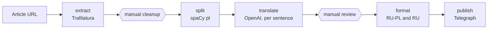

# stories_translator

**Turns a Polish news story into bilingual reading practice.** The pipeline extracts the article, splits it into sentences, translates each sentence with an LLM and lays the result out as Polish-Russian pairs plus a Russian-only version, ready to publish on Telegraph for a Telegram channel of Russian speakers learning Polish. Two manual review steps keep the translation honest.



**Stack:** Python · Trafilatura · spaCy (`pl_core_news_lg`) · OpenAI API · Telegraph API · Poetry

Generated articles are not kept in this repository: the source texts belong to their publishers.

## Pipeline Overview

1. URL is passed to `extractor` (Trafilatura) -> `url_extracted_text.txt`
2. **MANUAL**: `url_extracted_text.txt` is manually edited and verified against the original web page (cleanup + adding missing content)
3. `url_extracted_text.txt` is passed to `splitter` (spaCy): text is split into sentences
4. Split sentences are passed to `translator` (OpenAI GPT-4o), translated, and returned as a dictionary where each element contains the original sentence and its translation
5. Translation is saved in `json` format
6. **MANUAL**: `json` file is manually edited for final review
7. `json` file is passed to `formatter`, which saves the bilingual text (RU-PL)
8. `json` file is passed to `formatter`, which saves the Russian-only text (RU)

## Setup

1. Install dependencies:
   ```bash
   poetry install
   ```

2. Download the spaCy Polish language model:
   ```bash
   python -m spacy download pl_core_news_lg
   ```

3. Set up environment variables (create a `.env` file or export them):
   ```bash
   export OPENAI_API_KEY="your-openai-api-key"
   export DEEPL_AUTH_KEY="your-deepl-auth-key"  # optional, currently unused
   ```

## Usage

Edit `src/main.py` with your article URL, title, author, and date, then run:

```bash
python -m src.main
```

The pipeline will automatically detect which stage to run based on existing files in the `generated/` directory.

## TODO

### High Priority
- Make translations more literal, preserving word order as much as possible
- Add header with author, date, and original article link to translations

### Medium Priority
- Allow inserting images during text preparation (to avoid inserting them into two JSON files later)

### Low Priority
- Add URL cache for images to avoid uploading the same image twice for RU and RU-PL versions
- Add Russian announcement text generation for Telegram channel (may be expensive on API)

## License

[MIT](LICENSE)

---

Built by [Wiaczeslaw Cyunczyk](https://tslava.dev)
